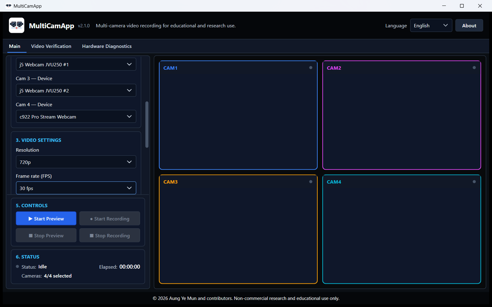
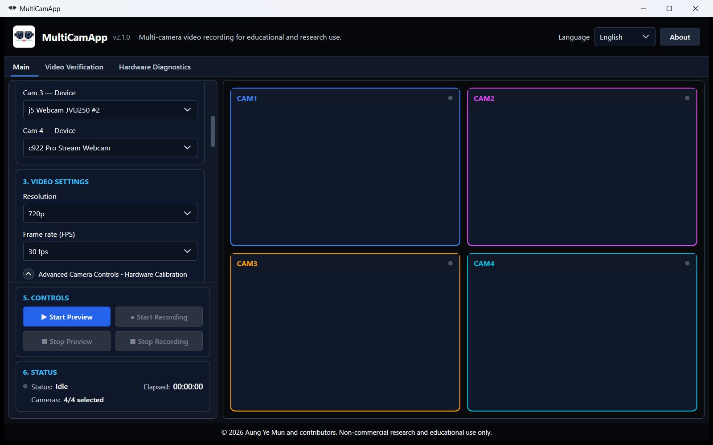
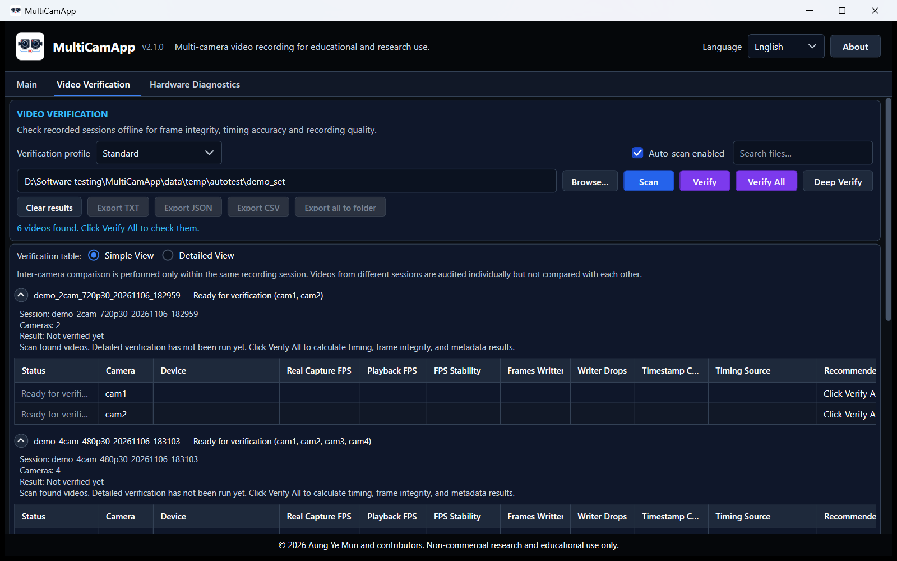
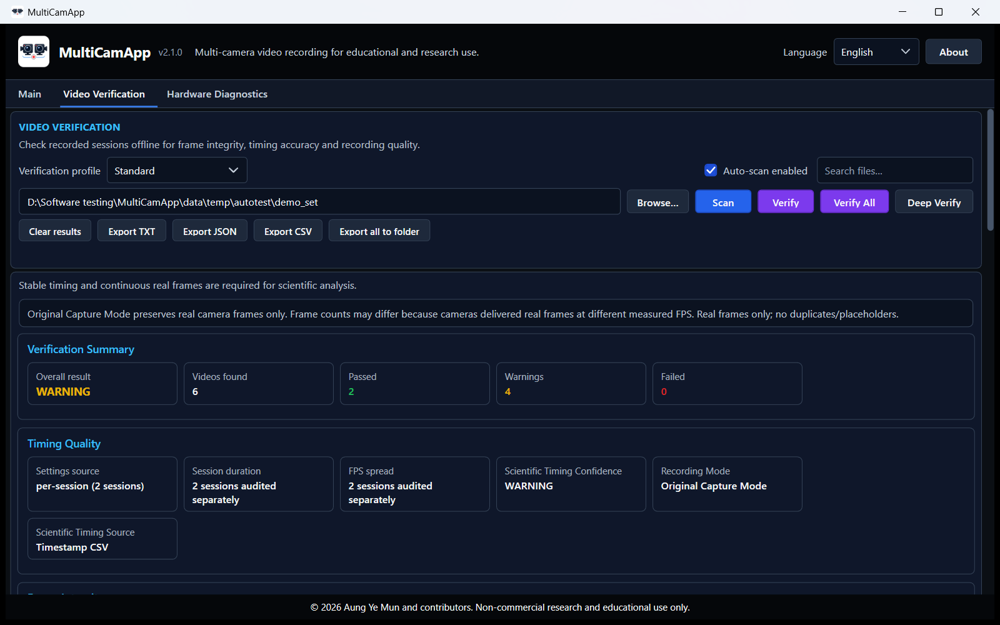
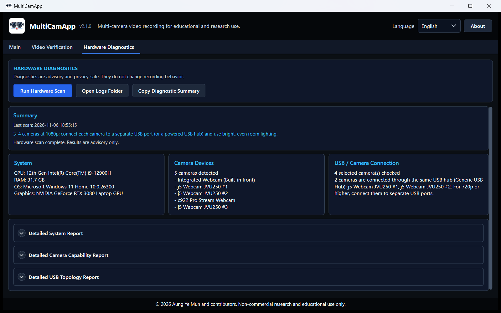
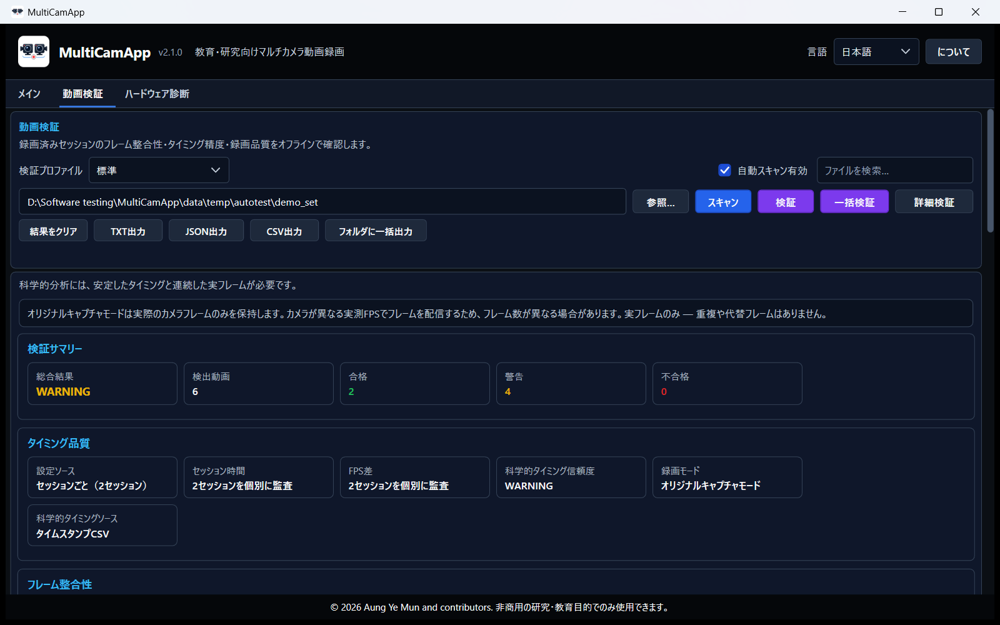

# MultiCamApp

**Offline Windows multi-camera recording, metadata capture, timestamp logging, and video verification software for educational, laboratory, and research use.**

MultiCamApp is a Windows desktop application designed to support reproducible video-based workflows. It allows users to record from 1–4 cameras, capture metadata, generate per-frame timestamp files, and verify recorded videos after acquisition.

Current release: **v2.1.0** (Stable)

---

## Overview

MultiCamApp provides an offline workflow for users who need controlled multi-camera video recording with timing information and post-recording verification.

It is suitable for educational and research settings where users need:

* Multi-camera video recording
* Offline operation
* Metadata capture
* Per-frame timestamp CSV files
* Video integrity and timing verification
* Clear recording-quality summaries
* Privacy-safe output files

MultiCamApp was originally developed for research video recording workflows, including behavioral and locomotor activity studies, but it can also support broader video-based educational and laboratory documentation needs.

---

## Potential Use Cases

MultiCamApp is not limited to one specific experiment type. Possible use cases include:

* Behavioral and locomotor activity recording
* Multi-angle experimental observation
* Educational demonstrations and teaching recordings
* Laboratory procedure documentation
* Video-based reproducibility studies
* Camera setup, focus, exposure, and recording-quality checks
* Offline research video capture
* Synchronized-view documentation where software-level timing verification is sufficient

MultiCamApp is especially useful when users need offline recording, metadata capture, timestamp files, and post-recording video verification.

---

## Key Features

* Supports **1–4 camera layouts**
* **VideoEngineV2** recording engine using Windows MediaFoundation — works on integrated graphics, no discrete GPU required
* Compatible with any Windows Camera-compatible webcam (USB 2.0/3.0, built-in laptop camera, cheap 1080p/720p webcams)
* Offline Windows recording workflow — no internet required
* Original Capture Mode that preserves real camera frames only (no duplicates, no placeholder frames)
* Per-frame timestamp CSV files for scientific timing analysis
* Metadata output in human-readable (TXT) and machine-readable (JSON) formats
* Metadata language follows the selected UI language (English or Japanese) at recording start
* English and Japanese UI localization
* Video Verification page with Simple View and Detailed View
* Scientific timing confidence reporting
* Privacy-safe metadata summaries
* Hardware diagnostics page
* High-stability recording mode (always enabled internally)
* Coordinated software start gate with timing verification for multi-camera sessions
* **Crash-safe recording:** videos are written as fragmented MP4, which stays playable if the app is closed unexpectedly, crashes, or the PC loses power. Interrupted sessions are recovered automatically at the next start, with a `RECOVERY_REPORT.txt`
* **Camera-independent mode selection:** uncompressed camera formats are preferred, and if a camera mode delivers no frames the app switches to the next compatible mode automatically (reported in the camera panel and metadata)
* **Anti-flicker (mains frequency) control**, default *Auto (camera)*, to prevent moving horizontal bands under fluorescent/LED light
* **Visual stability audit** in Deep Verify: light-flicker bands, brightness flashes, and temporal noise for every video
* **Manual exposure and focus that reach the camera** (standard UVC webcams included), confirmed by camera readback and recorded in the metadata
* **Video quality / file size presets:** Maximum (default, constant bitrate), High, Compact, and Efficient (constant quality — file size follows scene detail); expected MB per minute shown for the selected resolution and FPS
* **Fast recording start:** the hardware encoder is prepared in the background while previewing, so Start Recording takes about 0.3 s
* Offline installer
* Third-party notices and FFmpeg/ffprobe license files included

---

## Screenshots

Screenshots of the real application (v2.1.0, Windows 11). Video preview is off, so no camera images are shown. The verification pages show two demo sessions recorded for this purpose.

| Main window (4-camera layout) | Advanced camera controls |
| --- | --- |
|  |  |

| Video Verification: before a run | Video Verification: after Verify All and Deep Verify |
| --- | --- |
|  |  |

| Hardware Diagnostics | Japanese UI |
| --- | --- |
|  |  |

---

## Scope and Timing Model

MultiCamApp provides **software-based recording coordination**, timestamp logging, and post-recording verification.

It does **not** provide hardware-triggered camera synchronization.

This means:

* Cameras are started through a coordinated software start process.
* Each camera may still have small hardware/driver-dependent start-time offsets.
* Real measured camera FPS may differ slightly from the requested FPS.
* MultiCamApp records timing information and reports these differences instead of hiding them.
* For timing-sensitive analysis, users should review the timestamp CSV files and verification reports.

This design is intended to preserve scientific transparency.

---

## Download

End users should download the installer from the **GitHub Releases** page.

Recommended:

* Download `Setup.exe` to install MultiCamApp directly.

Optional:

* Download `installer.zip` if you want the installer together with important documentation.

The source repository is for development, review, documentation, and reproducible building. Installer binaries such as `Setup.exe` and `installer.zip` are not committed directly to the repository.

---

## Quick Start

1. Download `Setup.exe` or `installer.zip` from GitHub Releases.
2. Run the installer.
3. Launch **MultiCamApp** from the Desktop or Start Menu.
4. Select a 1–4 camera layout.
5. Assign camera devices to active camera slots.
6. Choose resolution and frame rate.
7. Click **Start Preview** and wait for active cameras to show live preview.
8. Click **Start Recording** when preview is ready.
9. Click **Stop Recording** when finished.
10. Open **Video Verification**, select the recorded session folder, and verify frame integrity, timing, and recording quality offline.

---

## Original Capture Mode

MultiCamApp uses **Original Capture Mode** (introduced in v1.1.0, still the default in the current VideoEngineV2 pipeline).

Original Capture Mode preserves real camera frames only. It does not insert duplicate frames or placeholder frames to force exact nominal FPS or equal frame counts.

Frame counts may differ between cameras because cameras can deliver real frames at slightly different measured FPS. For example, one camera may measure close to `30.000 FPS`, while another camera may measure around `29.x FPS`.

This is acceptable when:

* Frames captured match frames written
* Duplicate frames are 0
* Placeholder frames are 0
* Writer drops are 0
* Timestamp CSV rows match frames written
* Timing confidence is acceptable for the intended analysis

For timing-sensitive analysis, use the timestamp CSV files and verification reports as the primary scientific timing references.

---

## Output Files

Each recording session saves videos and metadata automatically.

Typical outputs may include:

* Recorded video files
* Per-frame timestamp CSV files
* Metadata JSON files
* Human-readable metadata TXT summaries
* Session summary files
* Video verification reports
* `RECOVERY_REPORT.txt` / `recovery_report.json` and `session_interrupted.json` — only for a session that was interrupted (app closed, crash, power loss) and recovered at the next start

The exact output structure depends on the selected camera layout and recording session.

---

## Video Verification

MultiCamApp includes an offline **Video Verification** page.

The verification system can help users review:

* Video readability
* Frame counts
* Timestamp CSV availability
* Timestamp row count consistency
* Duplicate frame count
* Placeholder frame count
* Writer queue drops
* Wall-clock duration
* Frame-based duration
* Container duration
* Measured camera FPS
* Inter-camera timing differences
* Scientific timing confidence
* Visual stability (Deep Verify): strength of moving light-flicker bands (% of brightness), brightness flashes, and temporal noise

Results and export buttons appear only after a verification run. Before a run, the page lists the sessions found as "Ready for verification". Reports can be exported as TXT, JSON and CSV, or all at once to the session folder.

Verification results are intended to help users decide whether a recording session is suitable for downstream analysis.

---

## Hardware Diagnostics

MultiCamApp includes hardware diagnostics to help users evaluate recording stability.

Diagnostics may include information related to:

* Camera availability
* Selected camera settings
* Recording performance
* Timing stability
* Writer queue behavior
* System-level recording risks
* Graphics adapters (name, driver version and date, memory as reported by Windows)
* USB topology: which USB host controller and which external USB hubs each selected camera is connected through, with a warning when two cameras share one hub

Only device names are reported; hardware IDs and serial numbers are not stored.

Recording stability can depend on camera hardware, USB bandwidth, CPU, RAM, disk speed, and camera drivers.

---

## Known Limitations

* Windows only.
* Recording performance depends on camera hardware, USB bandwidth, CPU, RAM, disk speed, and camera drivers.
* Some webcams may capture at a stable real FPS slightly below the requested FPS, such as 29.x FPS instead of exactly 30 FPS.
* Multi-camera recordings may have small hardware/driver-dependent start-time offsets.
* MultiCamApp provides software-based recording coordination and verification, but not hardware-triggered camera synchronization.
* Preview FPS is optimized for camera checking and usability; recorded video quality and timing information are the priority.
* **Moving horizontal bands** under fluorescent or LED light come from the light flickering at twice the mains frequency. Set *Anti-flicker* to your mains frequency (Japan: east 50 Hz, west 60 Hz) or *Auto*. Some cameras accept but ignore this setting (observed on one webcam model); for those, use non-flickering (DC) lighting.
* Manual exposure on standard USB webcams is limited to power-of-two shutter steps (for example 1/64 s, 1/32 s). These are not multiples of the light-flicker period and can produce bands; keep auto exposure with the anti-flicker setting unless a fixed shutter is required. A shutter longer than the frame interval lowers the frame rate (the app warns about this).
* Two webcams on one USB 2.0 hub may not both stream 720p or higher (USB bandwidth). Connect cameras to separate USB ports/controllers.
* Focus is locked at Start Recording at the position the camera reached during preview (research default). Some webcams' autofocus does not search again by itself; check sharpness in the preview, or set focus manually, before recording.
* The "Efficient" preset lowers file size most on clean, static scenes and smooths sensor noise more than "Maximum"; keep "Maximum" when pixel-level intensity or subtle motion is analysed.
* After an interrupted recording, the last fraction of a second to about one second may be missing, and per-camera metadata files are replaced by the recovery report.
* Not intended for clinical diagnosis, medical decision-making, or regulated medical use.

---

## Responsible Use

MultiCamApp is intended for lawful, consent-based recording only.

Do not use this software for illegal surveillance, spying, harassment, unauthorized recording, privacy invasion, or any activity that violates the rights, safety, or privacy of others.

Users are responsible for following applicable institutional policies, ethics approvals, local laws, and privacy regulations.

---

## Privacy

MultiCamApp is designed as an offline application.

The app does not require cloud services for normal recording and verification workflows. Output files are saved locally on the user's computer.

Users should still review exported files before sharing them publicly, especially videos, screenshots, reports, and metadata.

---

## Third-Party Components

MultiCamApp includes bundled third-party components, including FFmpeg/ffprobe and other runtime dependencies.

See:

* `THIRD_PARTY_NOTICES.md`
* `FFMPEG_LICENSE.txt`
* License files included with the installer or installation folder

---

## Documentation

Additional documentation:

* Installation Guide
* Directory Structure
* Third-Party Notices
* Output Files and Metadata
* Video Verification
* Hardware Diagnostics
* Architecture Overview
* Installer Logic
* Security and Antivirus
* Changelog

---

## Uninstallation

Use **Uninstall MultiCamApp** from the Start Menu or Windows Control Panel.

The uninstaller removes application files and bundled runtime components while preserving recorded videos, exported reports, and user project folders.

---

## Citation

If you use MultiCamApp in research, education, or published work, please cite:

Mun AY, Koketsu S. **MultiCamApp: Offline multi-camera recording, metadata capture, and video verification platform for research and educational workflows.** Version v2.1.0. 2026.

---

## Attribution

Original prototype workflow concept and foundational recording idea:

**Shinnosuke Koketsu**

Modern application architecture, UI/UX redesign, offline packaging, verification framework, diagnostics, metadata/reporting, localization, testing, release engineering, and maintenance:

**Aung Ye Mun**

---

## License

© 2026 Aung Ye Mun and contributors.

MultiCamApp is available for non-commercial academic, scientific, educational, evaluation, and personal use.

Commercial use, redistribution, resale, sublicensing, SaaS hosting, monetized distribution, or commercial incorporation is prohibited without prior written permission from the copyright holder.

See `LICENSE.md` for full details.
