# Getting started with MultiCamApp

This guide shows how to record with one to four webcams and check the recordings afterwards. No technical knowledge is needed. Each picture is followed by the same explanations in text.

The pictures come from the real application (version 2.1.0, English user interface). They use demo recordings with the camera preview turned off, and the user name in the save path is shown as `<you>`.

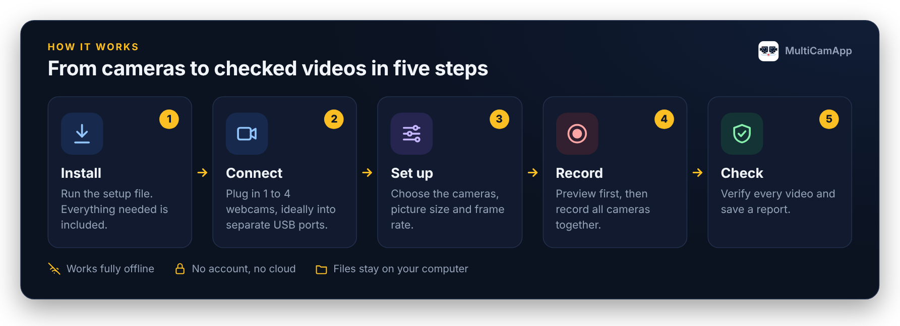

**Contents**

1. [Install](#1-install)
2. [Choose your cameras](#2-choose-your-cameras)
3. [Choose the picture settings](#3-choose-the-picture-settings)
4. [Choose where to save](#4-choose-where-to-save)
5. [Preview, then record](#5-preview-then-record)
6. [Find your recordings](#6-find-your-recordings)
7. [Check your recordings](#7-check-your-recordings)
8. [Read the results](#8-read-the-results)
- [Check your computer and cameras](#check-your-computer-and-cameras)
- [Version, licence and citation](#version-licence-and-citation)
- [Common questions](#common-questions)

## 1. Install

1. Download **`MultiCamApp_2.1.0.339_Setup.exe`** from the [latest release](https://github.com/aungyemun/MultiCamApp/releases/latest).
2. Double-click it and follow the installer. Everything the app needs is included, and no internet connection is required afterwards.
3. If Windows shows *"Windows protected your PC"*, click **More info → Run anyway**. This appears because the installer is not code-signed.
4. Open **MultiCamApp** from the Desktop or the Start Menu.

You need Windows 10 or 11 (64-bit) and 1 to 4 webcams that work with the Windows Camera app. See [INSTALLATION.md](../../INSTALLATION.md) for upgrading and uninstalling.

## 2. Choose your cameras

Plug in your webcams first, ideally each into its own USB port.

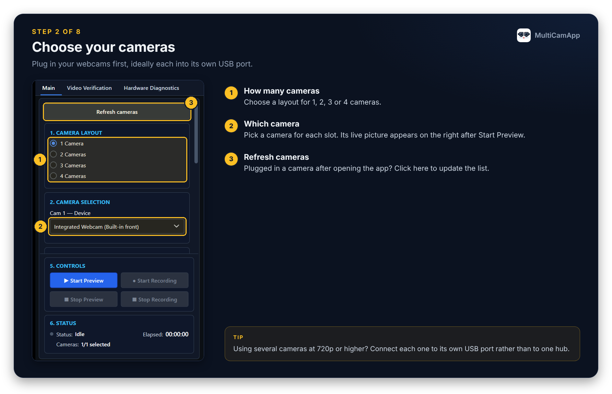

1. **How many cameras** — Choose a layout for 1, 2, 3 or 4 cameras.
2. **Which camera** — Pick a camera for each slot. Its live picture appears on the right after Start Preview.
3. **Refresh cameras** — Plugged in a camera after opening the app? Click here to update the list.

> [!TIP]
> Using several cameras at 720p or higher? Connect each one to its own USB port rather than to one hub.

## 3. Choose the picture settings

Scroll down the left panel. If you are unsure, keep 720p and 30 fps.

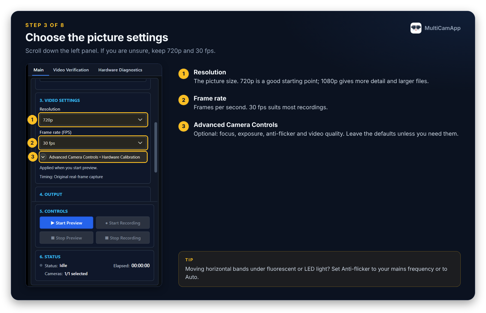

1. **Resolution** — The picture size. 720p is a good starting point; 1080p gives more detail and larger files.
2. **Frame rate** — Frames per second. 30 fps suits most recordings.
3. **Advanced Camera Controls** — Optional: focus, exposure, anti-flicker and video quality. Leave the defaults unless you need them.

> [!TIP]
> Moving horizontal bands under fluorescent or LED light? Set Anti-flicker to your mains frequency or to Auto.

## 4. Choose where to save

Recordings stay on your computer. Nothing is uploaded.

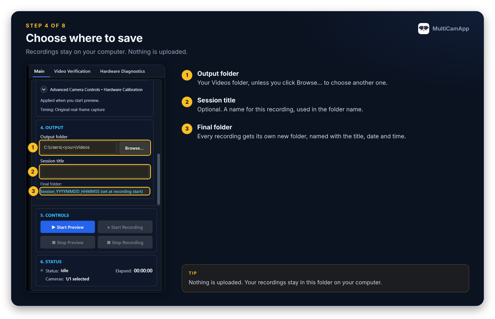

1. **Output folder** — Your Videos folder, unless you click Browse... to choose another one.
2. **Session title** — Optional. A name for this recording, used in the folder name.
3. **Final folder** — Every recording gets its own new folder, named with the title, date and time.

> [!TIP]
> Nothing is uploaded. Your recordings stay in this folder on your computer.

## 5. Preview, then record

The live pictures appear on the right side of the window.

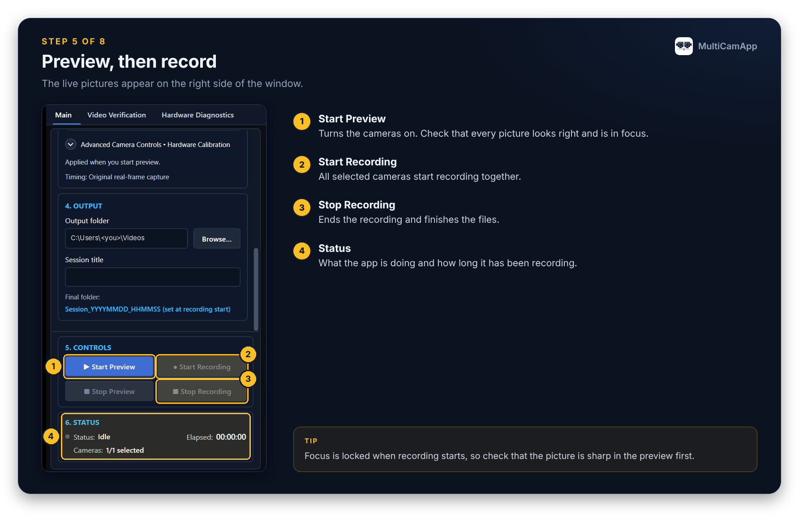

1. **Start Preview** — Turns the cameras on. Check that every picture looks right and is in focus.
2. **Start Recording** — All selected cameras start recording together.
3. **Stop Recording** — Ends the recording and finishes the files.
4. **Status** — What the app is doing and how long it has been recording.

> [!TIP]
> Focus is locked when recording starts, so check that the picture is sharp in the preview first.

If the computer shuts down or the app closes during a recording, the video stays playable. The app recovers it the next time it starts and writes a `RECOVERY_REPORT.txt`; the last moments of the recording may be missing.

## 6. Find your recordings

Every recording is saved in its own folder:

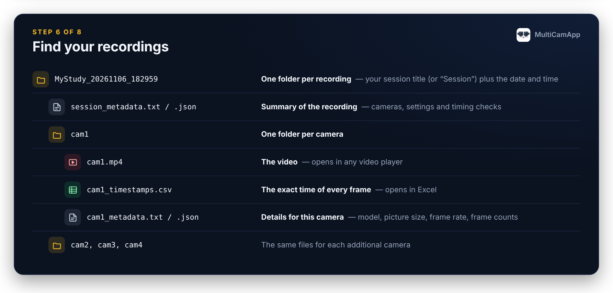

| File | What it is |
| --- | --- |
| `session_metadata.txt` / `.json` | Summary of the recording: cameras, settings and timing checks |
| `cam1\cam1.mp4` | The video; opens in any video player |
| `cam1\cam1_timestamps.csv` | The exact time of every frame; opens in Excel |
| `cam1\cam1_metadata.txt` / `.json` | Details for this camera: model, picture size, frame rate, frame counts |

`cam2`, `cam3` and `cam4` contain the same files for the other cameras. Every field is described in [Output Files and Metadata](../OUTPUT_FILES_AND_METADATA.md).

## 7. Check your recordings

Open the Video Verification tab. Everything is checked on your computer, offline.

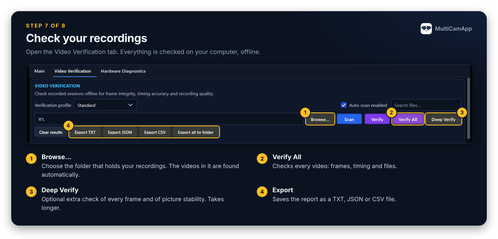

1. **Browse...** — Choose the folder that holds your recordings. The videos in it are found automatically.
2. **Verify All** — Checks every video: frames, timing and files.
3. **Deep Verify** — Optional extra check of every frame and of picture stability. Takes longer.
4. **Export** — Saves the report as a TXT, JSON or CSV file.

## 8. Read the results

The top of the results gives one answer for the whole folder.

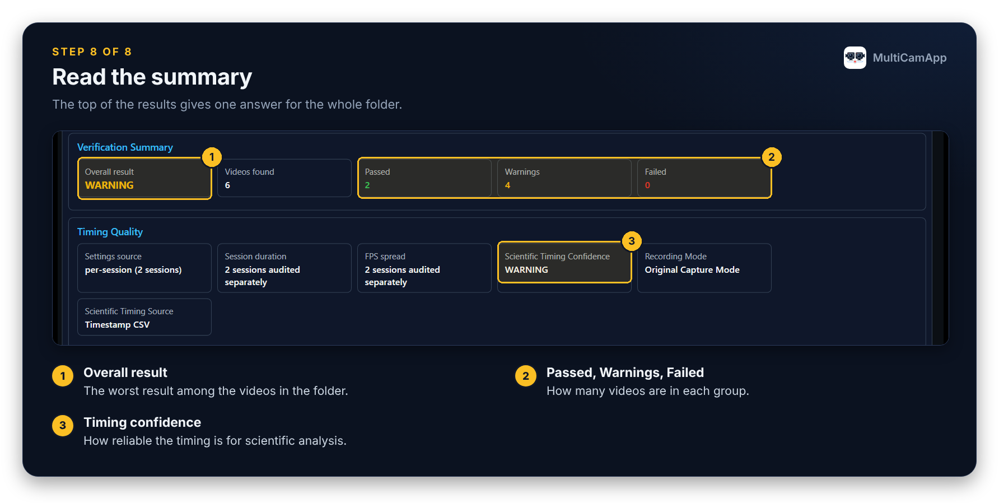

1. **Overall result** — The worst result among the videos in the folder.
2. **Passed, Warnings, Failed** — How many videos are in each group.
3. **Timing confidence** — How reliable the timing is for scientific analysis.

What the results mean:

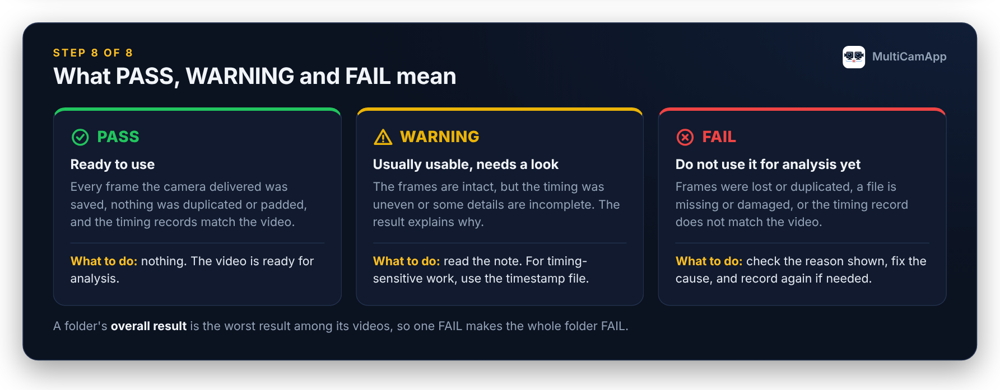

| Result | Meaning | What to do |
| --- | --- | --- |
| **PASS** | Every frame the camera delivered was saved, nothing was duplicated or padded, and the timing records match the video. | Nothing. The video is ready for analysis. |
| **WARNING** | The frames are intact, but the timing was uneven or some details are incomplete. The result explains why. | Read the note. For timing-sensitive work, use the timestamp file. |
| **FAIL** | Frames were lost or duplicated, a file is missing or damaged, or the timing record does not match the video. | Check the reason shown, fix the cause, and record again if needed. |

A folder's overall result is the worst result among its videos, so one FAIL makes the whole folder FAIL.

Further down, every recording session has its own table.

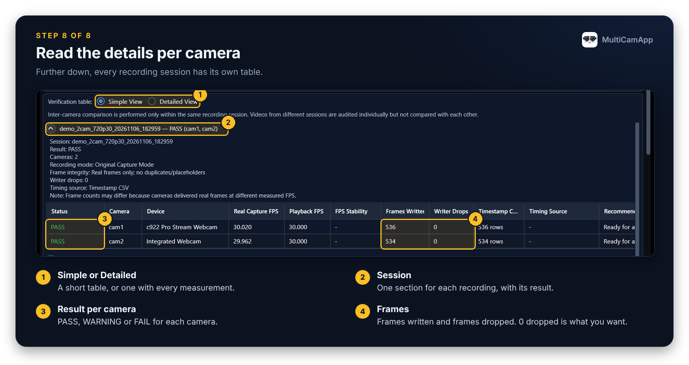

1. **Simple or Detailed** — A short table, or one with every measurement.
2. **Session** — One section for each recording, with its result.
3. **Result per camera** — PASS, WARNING or FAIL for each camera.
4. **Frames** — Frames written and frames dropped. 0 dropped is what you want.

Every check is explained in the [Video Verification guide](video_verification.md).

## Check your computer and cameras

The Hardware Diagnostics tab helps when a camera is slow, missing or drops frames.

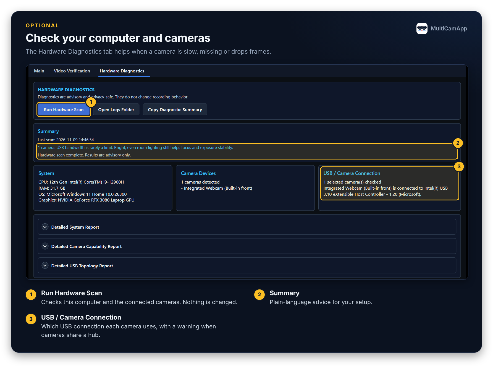

1. **Run Hardware Scan** — Checks this computer and the connected cameras. Nothing is changed.
2. **Summary** — Plain-language advice for your setup.
3. **USB / Camera Connection** — Which USB connection each camera uses, with a warning when cameras share a hub.

More in [Hardware Diagnostics](hardware_diagnostics.md).

## Version, licence and citation

Click About at the top right of the main window.

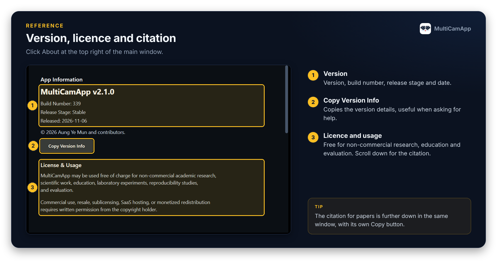

1. **Version** — Version, build number, release stage and date.
2. **Copy Version Info** — Copies the version details, useful when asking for help.
3. **Licence and usage** — Free for non-commercial research, education and evaluation. Scroll down for the citation.

> [!TIP]
> The citation for papers is further down in the same window, with its own Copy button.

To switch the language between **English** and **日本語**, use the **Language** menu at the top right of the main window.

## Common questions

**A camera is missing from the list.** Check that it works in the Windows Camera app, close other programs that use it, then click **Refresh cameras**.

**Moving horizontal bands appear in the picture.** Fluorescent and LED lights flicker. Open *Advanced Camera Controls* and set **Anti-flicker** to your mains frequency (Japan: east 50 Hz, west 60 Hz) or to *Auto*. Some cameras ignore this setting; for those, use non-flickering lighting.

**Two cameras do not both work at 720p or higher.** They are probably sharing one USB hub. Connect each camera to its own USB port, or choose a lower resolution. **Hardware Diagnostics** shows which connection each camera uses.

**The cameras have slightly different frame counts.** This is expected: each camera delivers frames at its own real rate, and MultiCamApp saves only real frames. The timestamp files give the exact time of every frame.

**Does MultiCamApp need the internet or an account?** No. It works fully offline, and recordings stay on your computer.

For anything else, see the [README](../../README.md#known-limitations) and the other guides in this folder.
